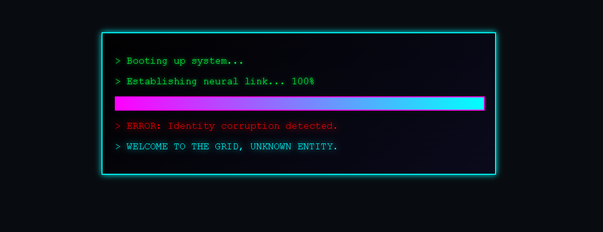
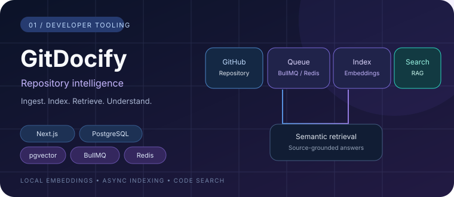
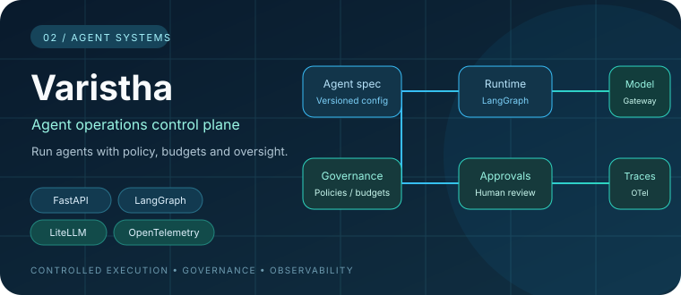
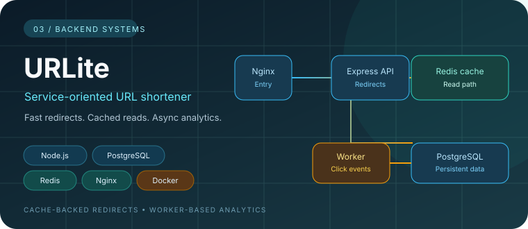
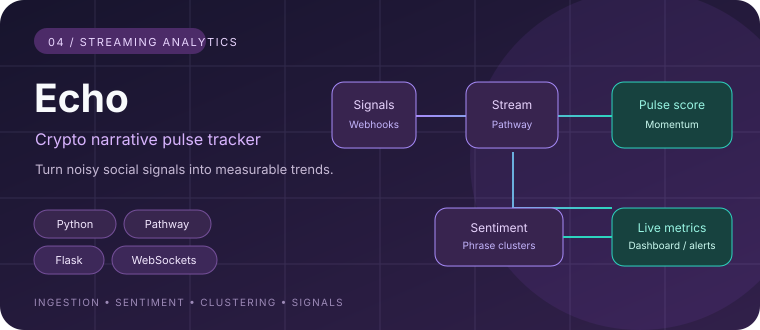

<h2>🟢 WeLcomE  t()  dYstopiA</h2>

  
  
<a href="https://ssrinibass.github.io/CyberpunkTerminal/"><strong>↗ LAUNCH SYSTEM CHECKUP</strong></a>

  
  
  

## About

Software engineer focused on **backend platforms, data-intensive applications, and distributed workflows**. At **Deloitte India**, I contribute to banking analytics and AI-agent observability. Outside work, I build independent products spanning developer tooling, asynchronous processing, and system design.

**Currently exploring:** the engineering foundations of reliable agent platforms through [Varistha](https://github.com/SSRINIBASS/varistha).

## Selected work

<table>
  <tr>
    <td width="50%" valign="top">
      
      <h3><a href="https://github.com/SSRINIBASS/gitdocify">GitDocify</a></h3>
      
<strong>Repository intelligence &amp; semantic code search</strong>

      
Asynchronous repository ingestion, local embeddings, PostgreSQL/pgvector retrieval, and codebase Q&amp;A grounded in source context.

      
 <a href="https://github.com/SSRINIBASS/gitdocify">Source ↗</a>

    </td>
    <td width="50%" valign="top">
      
      <h3><a href="https://github.com/SSRINIBASS/varistha">Varistha</a></h3>
      
<strong>AI-agent operations control plane</strong>

      
An active-development prototype exploring agent lifecycle, controlled execution, governance policies, approvals, evaluation, identity, and OpenTelemetry.

      
<a href="https://github.com/SSRINIBASS/varistha">Explore implementation ↗</a>

    </td>
  </tr>
  <tr>
    <td width="50%" valign="top">
      
      <h3><a href="https://github.com/SSRINIBASS/urlite">URLite</a></h3>
      
<strong>Service-oriented URL shortener</strong>

      
Cache-backed redirects, PostgreSQL persistence, Redis click-event handoff, and a separate analytics worker.

      
<a href="https://github.com/SSRINIBASS/urlite">Explore implementation ↗</a>

    </td>
    <td width="50%" valign="top">
      
      <h3><a href="https://github.com/SSRINIBASS/echo">Echo</a></h3>
      
<strong>Streaming crypto-narrative analytics</strong>

      
Social-signal ingestion, sentiment processing, phrase clustering, pulse scoring, and real-time metrics with optional alerts.

      
<a href="https://github.com/SSRINIBASS/echo">Explore implementation ↗</a>

    </td>
  </tr>
</table>

  
<strong>More engineering work</strong>

  - **[ccwc-cpp](https://github.com/SSRINIBASS/ccwc-cpp)** — C++ implementation inspired by the Unix `wc` command, with file and standard-input support. Its compile and smoke-test workflow is passing.
  - **[codeRipper](https://github.com/SSRINIBASS/codeRipper)** — earlier repository-intelligence prototype; GitDocify is the active successor.

## Technology

  

**Engineering interests:** API design · Data structures &amp; algorithms · SQL · Asynchronous processing · Unit testing · CI/CD · Observability

## Beyond the code

- **ICPC Amritapuri Preliminary Contest 2025:** All India Rank 1,186 / 2,930.
- **Community:** Former Coordinator, Enigma Web &amp; Coding Club, VSSUT; helped organise DevTalk 2026 with engineers from Google and Amazon.

## Contributions

  <picture>
    <source media="(prefers-color-scheme: dark)" srcset="https://raw.githubusercontent.com/SSRINIBASS/SSRINIBASS/output/github-snake-dark.svg"/>
    <source media="(prefers-color-scheme: light)" srcset="https://raw.githubusercontent.com/SSRINIBASS/SSRINIBASS/output/github-snake.svg"/>
    
  </picture>

  Build useful things. Understand the systems behind them. Keep improving.

