  
  
  

## About

Software engineer focused on **backend platforms, data-intensive applications, and distributed workflows**. At **Deloitte India**, I contribute to banking analytics and AI-agent observability. I also build independent products spanning developer tooling, asynchronous processing, and system design.

Currently exploring the engineering foundations of reliable agent platforms through **[Varistha](https://github.com/SSRINIBASS/varistha)**.

## Selected work

| Project | What it demonstrates |
|---|---|
| **[URLite](https://github.com/SSRINIBASS/urlite)** | Service-oriented URL shortener with Express, PostgreSQL, Redis-backed caching, and a separate analytics worker. |
| **[GitDocify](https://github.com/SSRINIBASS/gitdocify)** | Repository intelligence platform with asynchronous ingestion, local embeddings, and semantic code retrieval using pgvector. |
| **[Varistha](https://github.com/SSRINIBASS/varistha)** | AI-agent control-plane prototype exploring runtime integration, governance, approvals, evaluation, identity, and OpenTelemetry. |
| **[Echo](https://github.com/SSRINIBASS/echo)** | Streaming crypto-narrative analytics with sentiment processing, phrase clustering, pulse scoring, and real-time metrics. |

  
<strong>More engineering work</strong>

  - **[ccwc-cpp](https://github.com/SSRINIBASS/ccwc-cpp)** — C++ implementation inspired by the Unix `wc` command, with file and standard-input support.
  - **[codeRipper](https://github.com/SSRINIBASS/codeRipper)** — earlier repository-intelligence prototype; GitDocify is the active successor.

## Technology

  

**Core interests:** API design · Data structures & algorithms · SQL · Asynchronous processing · Unit testing · CI/CD · Observability

## A little more

- **ICPC Amritapuri Preliminary Contest 2025:** All India Rank 1,186 / 2,930.
- **Community:** Former Coordinator, Enigma Web & Coding Club, VSSUT; helped organise DevTalk 2026 with engineers from Google and Amazon.

## Contributions

  <picture>
    <source media="(prefers-color-scheme: dark)" srcset="https://raw.githubusercontent.com/SSRINIBASS/SSRINIBASS/output/github-snake-dark.svg"/>
    <source media="(prefers-color-scheme: light)" srcset="https://raw.githubusercontent.com/SSRINIBASS/SSRINIBASS/output/github-snake.svg"/>
    
  </picture>

  Build useful things. Understand the systems behind them. Keep improving.

